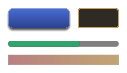

# Game UI

<p class="awake-lede">A HUD that belongs to the scene: text, panels, bars, buttons, a typed field, images and touch joysticks pinned to the screen. Each element is a component on a scene entity, so it saves and loads with the scene, and the scene runtime draws it over the game.</p>

<div class="awake-badges" markdown>
<span class="awake-badge">component: <code>canvas_element</code></span>
<span class="awake-badge">module: <code>awake:scene:canvas</code></span>
<span class="awake-badge awake-badge--ok">Vulkan</span>
<span class="awake-badge awake-badge--ok">WebGPU</span>
<span class="awake-badge">Desktop · Android · iOS · Web</span>
</div>

Game UI is scene data. For menus, editors and tools written in Kotlin, use
[AwakeKt Compose](ui.md) instead.

## Add a HUD

Give each element its own entity with a `canvas_element` component. This HUD has a health bar in
the top-left corner, a score in the top-right corner and a jump button in the bottom-right corner.
Both forms below build the same components.

=== "Scene document"

    ```json title="hud.scene.json"
    --8<-- "website/docs/snippets/ui/hud.scene.json"
    ```

=== "Scene DSL"

    ```kotlin title="Kotlin"
    --8<-- "awake/scene/authoring/src/desktopTest/kotlin/com/awakekt/awake/scene/authoring/GameUiDocsSampleTest.kt:hud-dsl"
    ```

    The scene DSL has no dedicated function for canvas elements. `configure(::CanvasElement) { … }`
    attaches one and sets its fields.

There is no Studio tab: AwakeKt Studio has no inspector for `canvas_element` yet.

## React to a button

A game system polls the button. `consumePress()` returns `true` once for each tap, then `false`
until the next tap.

```kotlin title="Kotlin"
--8<-- "awake/scene/authoring/src/desktopTest/kotlin/com/awakekt/awake/scene/authoring/GameUiDocsSampleTest.kt:jump-system"
```

For a button the player holds down, read `isHeld` instead. For a joystick, read `stickX` and
`stickY`.

Without code, a blueprint on any node of the scene reacts to the button. Its On Button Pressed node
names the button by its node's name, or leaves the name empty to listen to the button on its own
node. Set Text and Set Visible change another element, named the same way:

```text
On Button Pressed (name: Play) -> Set Text (name: Title, text: Loading) -> Set Visible (name: Window, visible: false)
```

The project needs the blueprint capability. A blueprint takes no tap from the button: its `action`,
or a system polling `consumePress()`, sees the tap as it would without the blueprint.

## Properties

| Property | Type | Default | What it does |
| --- | --- | --- | --- |
| `kind` | `Text` · `Panel` · `Bar` · `Button` · `TextField` · `Joystick` · `Image` · `View` · `LookArea` | `Text` | What the element draws. A `LookArea` is a region where a swipe looks and a pinch zooms. |
| `anchor` | `TopLeft` · `TopCenter` · `TopRight` · `CenterLeft` · `Center` · `CenterRight` · `BottomLeft` · `BottomCenter` · `BottomRight` | `TopLeft` | The screen point the element is pinned to. |
| `offsetX` | number (dp) | `16` | Moves the element inward from its anchor. From a right anchor it moves left. On a centred axis it moves right of centre, or left when negative. |
| `offsetY` | number (dp) | `16` | Moves the element inward from its anchor. From a bottom anchor it moves up. On a centred axis it moves below centre, or above when negative. |
| `width` | number (dp) | `200` | Element width. A joystick is a round pad of this width. |
| `height` | number (dp) | `40` | Element height. |
| `text` | string | `""` | A `Text` element's content, a `Button`'s label, or what is typed into a `TextField`. Typing writes it; a system writing it replaces the field's content, caret at the end. |
| `textKey` | string | `""` | A `Text`'s or `Button`'s words from the project's string tables, by key, in the player's language. Use it in place of `text`. See [Show text in the player's language](#show-text-in-the-players-language). |
| `textArgs` | object | `{}` | Values for `textKey`'s placeholders, by name, such as `{ "count": "3" }`. |
| `fontSize` | number (sp) | `18` | Size of `text`. |
| `font` | string | `""` | The font of `text`: a `.ttf` or `.otf` file from the project, or a built-in family. See [Use a font](#use-a-font). |
| `mask` | string | `""` | A `TextField`'s password mask: one character drawn for each typed one. Empty shows the text. |
| `maxLength` | integer | `0` | The most a `TextField` lets the player type; `0` for no limit. See [Limit what is typed](#limit-what-is-typed). |
| `maxLengthUnit` | `Graphemes` · `CodePoints` · `Utf8Bytes` | `Graphemes` | What `maxLength` counts. |
| `placeholder` | string | `""` | A `TextField`'s hint while it is empty and unfocused: a key in the string tables, drawn muted. See [Pad a field and hint at it](#pad-a-field-and-hint-at-it). |
| `padding` | object | `{ "horizontal": 12, "vertical": 0 }` | The space between a `TextField`'s edge and its text, in dp. |
| `tooltip` | string | `""` | A hint any element shows near the pointer after half a second over it: a key in the string tables. |
| `pressable` | boolean | `false` | Lets an `Image` or `Panel` take a tap as a `Button` does. Without it, a tap passes through. |
| `textAlign` | one of the nine anchor points | none | Where the text sits in the element. None keeps a `Text` at its top-left and a `Button`'s label centred. |
| `follow` | string | `""` | A node to follow on screen. See [Follow a node](#follow-a-node). |
| `followOffset` | vector | `{x: 0, y: 0, z: 0}` | A world-space offset from the followed node. |
| `followBounds` | boolean | `false` | Cover the followed node's screen box instead of standing at its point. |
| `followOutset` | number | `0` | With `followBounds`, how far the box reaches past the node's on each side, in dp. Negative pulls it in. |
| `followRules` | object | none | Culling, ranking, scale and fade by distance, and edge pinning for a follower. See [Many followers](#many-followers). |
| `followArrow` | boolean | `false` | Inside a follower pinned to the edge, the arrow that points to its target. |
| `layout` | object | none | Lay the children out in rows or columns. See [Lay out children](#lay-out-children). |
| `grow` | number | `0` | In a laid-out parent, this element's share of the leftover space. |
| `bind` | object | none | Game state the element shows without code. See [Show game state](#show-game-state). |
| `camera` | string | `""` | A `View`'s camera node. See [Show a 3D view](#show-a-3d-view). |
| `color` | `#RRGGBB` or `#RRGGBBAA` | `#FFFFFF` | Text colour, a `Bar`'s fill, or a `Joystick`'s knob. |
| `background` | `#RRGGBB` or `#RRGGBBAA` | `#00000000` | Fill behind the element. A joystick's pad. |
| `value` | number, 0 to 1 | `1` | A `Bar`'s fill fraction. |
| `order` | integer | `0` | Draw order. Lower values draw first, so higher ones sit on top. |
| `visible` | boolean | `true` | Hidden elements are not drawn and take no taps. |
| `action` | string | `""` | Names what the element does for the game, such as `move` or `jump`. The game decides what each name means. |
| `doubleAction` | string | `""` | What a Button does when double-clicked, such as equipping an item; two presses within half a second. |
| `touchOnly` | boolean | `false` | Draw the element only where touch controls are shown. |
| `safeArea` | boolean | `true` | Keep the element clear of a notch, rounded corners or a home indicator. See [Keep clear of a notch](#keep-clear-of-a-notch). |
| `style` | object | `{}` | How the element looks beyond its colours: shape, border, gradient, shadow, images and button states. See [Style an element](#style-an-element). |

A running `CanvasElement` also has values that are not saved:

| Member | Type | What it gives |
| --- | --- | --- |
| `consumePress()` | `Boolean` | `true` once for each tap on a `Button` since the last call. |
| `consumePressAt()` | `Vec2?` | Where that tap landed, in the element's own units from its top-left, whatever the canvas's scale, and on a rotated element the point on its picture as if unturned; then takes the tap as `consumePress()` does. `null` when there is none. A map picture, as a pressable `Image`, turns it into a place. |
| `presses` | `Int` | How many times a `Button` has been tapped since it was made. Reading it takes no tap. |
| `isHeld` | `Boolean` | Whether a `Button` is pressed right now. |
| `stickX`, `stickY` | `Float`, -1 to 1 | A `Joystick`'s deflection. Up is negative `stickY`, as on screen. Releasing re-centres it. |
| `cooldown`, `charges`, `enabled` | `Float`, `Int`, `Boolean` | An action button's cooldown left (0 to 1), uses left (below 0 for none), and whether it can be pressed. See [Action buttons](#action-buttons). |
| `consumeDown()`, `consumeRelease()`, `consumeLongPress()`, `consumeReady()` | `Boolean` | `true` once for each time an action button went down, was let go, was held long, or became usable again. |
| `heldSeconds` | `Float` | How long an action button has been held. |
| `aiming`, `aimX`, `aimY`, `aimCancelling`, `aimTarget` | | An aimed button's drag: whether it is aiming, its aim (-1 to 1, up negative), whether it is over the cancel zone, and what `aimLock` locked onto. See [Drag to aim](#drag-to-aim). |
| `consumeAimCancel()` | `Boolean` | `true` once for each aimed shot let go over its cancel zone. |
| `consumeLook()`, `consumeZoom()` | `Vec2`, `Float` | A `LookArea`'s swipe since the last call, in dp times its sensitivity, and the factor its pinch spread by, 1 for none. |
| `aimLock` | `CanvasAimLock?` | Set from code: locks an aim onto a target the game picks. |
| `focused` | `Boolean` | Whether a `TextField` holds the keyboard. Set it `true` to focus the field, or `false` to free it; it reads back whatever a click, Enter, Escape, or anything else taking focus away leaves it at. |
| `consumeSubmit()` | `String?` | The submitted line once after Enter submits a `TextField` since the last call, taken from the field's live state so a character typed the same frame is included; `null` otherwise. Submitting frees its focus. Escape frees focus without submitting. An Enter that only just focused the field, in the same frame a system granted it, does not also submit it. |

## Action buttons

Give a `Button` `button` settings to make it an on-screen action button, as a skill, a reload or a
dash needs:

```json
{ "component": "canvas_element", "kind": "Button", "anchor": "BottomRight", "width": 72, "height": 72,
  "text": "Dash", "action": "dash", "touchOnly": true,
  "button": { "trigger": "Down", "longPressSeconds": 0.6, "longPressAction": "dash_info", "releaseAction": "" },
  "bind": { "node": "Player", "cooldown": "dash.left", "cooldownMax": "dash.seconds", "charges": "dash.charges" },
  "style": { "cornerRadius": 36, "disabled": { "alpha": 0.3 } } }
```

- `trigger` fires `action` on a `Tap`, released over the button, or the moment it goes `Down`.
- Held past `longPressSeconds`, it reports `consumeLongPress()` and presses `longPressAction`, and then
  the release is not also a tap.
- Let go anywhere, it reports `consumeRelease()` and presses `releaseAction`.
- `cooldownSeconds` gives the button a cooldown of its own: each time it fires, `cooldown` starts at
  1 and runs down to 0 over that many seconds, with no code. Leave it 0 for a cooldown the game owns.
- `cooldown`, from 1 just used to 0 ready, sweeps a shade over the button, and `charges` of 0 or more
  show in a badge. While it is cooling down with no charge left, the button takes no press unless
  `blockWhileCooling` is `false`; `consumeReady()` is `true` once each time it becomes usable again.
- `enabled: false`, or a `bind.enabled` field that reads false, disables it: it takes no press, keeps
  the press from what is under it, and draws in `style.disabled`, or dimmed.

### Look area and button cluster

A `LookArea` is a region where one thumb's swipe turns the camera and two thumbs pinch to zoom, as
the right half of the screen does in many touch games:

```json
{ "component": "canvas_element", "kind": "LookArea", "anchor": "TopRight", "offsetX": 0, "offsetY": 0,
  "width": 400, "height": 600, "touchOnly": true,
  "look": { "sensitivity": 1.2, "invertY": false, "pinchZoom": true, "zoomSensitivity": 1 } }
```

In a played project its swipe turns the scene's active camera rig and its pinch zooms it, unless
`turnsCamera` is `false`; an `action` naming an axis action gets the swipe, up positive, and
`zoomAction` gets the pinch as `ln` of its factor. From code, `consumeLook()` and `consumeZoom()` read
them. A look area takes up to two thumbs, so a thumb on a stick or a button is never taken from it.

A `cluster` places an element's children as a button cluster instead of a `layout`: the first, the
main button, on a pivot, and the rest on an arc around it, angles clockwise from the right:

```json
{ "component": "canvas_element", "kind": "Panel", "anchor": "BottomRight", "width": 260, "height": 260,
  "cluster": { "pivotX": 0.7, "pivotY": 0.7, "radius": 110, "startAngle": 180, "spacing": 45 } }
```

Keep the element big enough to hold the arc: a child outside its parent's box is drawn but may not
take a touch.

### A mobile controls scene

This scene is a complete touch layout for a third-person scene: a floating stick on the left that
runs when pushed to its edge, a look area on the right half that turns the camera, and a cluster of a
jump button and two skills with cooldowns, the second dragged to aim at the ground. Touch controls
show once a finger touches the screen and hide once a controller or keyboard is used, all in the
`MinimalFlat` theme with an orange accent.

```json title="mobile-controls.scene.json"
--8<-- "website/docs/snippets/ui/mobile-controls.scene.json"
```

`skill1` and `skill2` are the scene's own actions, so the game reads them with
`actions.wasPressed("skill1")`, and the second skill's aim with `actions.axisX("aim")` and
`actions.axisY("aim")` on the frame it fires.

### Show touch controls by input

A scene's `canvas_controls` decides when its `touchOnly` elements show, for every control at once:

```json
{ "component": "canvas_controls", "touchVisibility": "Auto", "minTouchSize": 44 }
```

`Auto` shows them once a finger touches the screen and hides them once a controller, a key or the
mouse is used, switching live, so one build serves a phone, a tablet with a keyboard, and a desktop
with a controller. Until any is used it does what the host says. `Always` and `Never` override the
host. A control hidden mid-press lets go of its pointer, so a stick never stays deflected while it
cannot be seen. `minTouchSize` keeps small controls easy to hit: a button drawn smaller than it takes
a touch up to that size around its centre. `SceneAppLifecycleRuntime.lastInputDevice` says which
device the player last used.

Every stick, action button and look area follows only the pointers that landed on it first, so a
thumb steering a stick, another pressing a button and a third turning the camera never take each
other's touches.

### Theme the controls

The kit owns how a control behaves, never how it looks. Every visual part is a slot: a stick's
`base`, `knob`, `sprintRing` and `arrows`; a button's `background`, `icon`, `label`, `cooldown`,
`charges`, `aimCursor`, `aimRange` and `cancelZone`; a look area's `feedback`. A scene's
`canvas_controls.theme` fills them for every control at once, and an element's own `skin` fills
them for that one:

```json
{ "component": "canvas_controls", "touchVisibility": "Auto",
  "theme": {
    "preset": "Glass",
    "colors": { "accent": "#FFB347" },
    "skin": {
      "button": {
        "icon": { "size": 40, "style": { "image": { "path": "@dash" } } },
        "background": { "circle": true, "transitionSeconds": 0.15,
          "states": { "Pressed": { "scale": 0.92 }, "Ready": { "scale": 1.15 },
                      "Disabled": { "alpha": 0.35 } } } } },
    "images": { "dash": { "path": "ui/dash.png" } } } }
```

- **A style** is the same `style` an element has: colour, gradient, corner radius, border, shadow,
  opacity, and `circle` for a round part.
- **Images** are its `image`, a single picture, a nine-slice frame or an atlas region, a different
  one in any state, or `frames` played as a sprite animation.
- **Custom content** is `custom`, the name of a composable the host registered with
  `SceneAppLifecycleRuntime.canvasSlotContent` (or `CanvasOverlay(slotContent = ...)`), drawn in the
  slot's box and given the control and its state.

States drive the look: `Idle`, `Pressed`, `Held`, `Disabled`, `CoolingDown`, `Ready` (a short pulse
when a button is usable again), `Aiming` and `Cancelling`. Each state may change a slot's `style`,
`scale`, `alpha`, `frames` or `hidden`, faded in over `transitionSeconds`; a state a slot does not
change falls back to a broader one. `colors` and `images` are tokens a slot writes as `@name`, so
changing one restyles every control, and a game can ship a light, a dark and a high-contrast theme
and switch between them by setting `CanvasControls.theme`. The built-in presets, `MinimalFlat`,
`Glass` and `Textured`, are plain data to start from; `Textured` names `controls/pad.png`,
`controls/knob.png`, `controls/button.png` and `controls/button-pressed.png`, which a project
provides or replaces through `images`. An editor previews one state with `previewState`.

Players can scale, move and fade the controls too. Give each control a `controlId`, and set
`CanvasControls.playerLayout`: every touch control's `scale` and `opacity`, and each control's own
`offsetX`, `offsetY`, `scale` and `opacity`. `CanvasPlayerLayout.toJson()` and `fromJson()` save and
load it, and `moved(id, dx, dy)` follows a drag on a settings screen.

### Drag to aim

Add `aim` to a button's settings and a drag away from it aims, then letting go fires `action` with
that aim, wherever the thumb is:

```json
"button": { "aim": { "mode": "Ground", "radius": 120, "deadZone": 0.2, "aimAction": "aim",
                     "cancel": { "anchor": "TopCenter", "offsetY": 24, "width": 72, "height": 72 } } }
```

- `aimX` and `aimY`, from -1 to 1 with up negative, are the drag from where the press landed as a
  share of `radius`: a unit `Direction`, or as far out as the drag for a `Ground` target. A drag
  inside `deadZone` is no aim, so a quick tap fires at whatever the game picks.
- While it is dragged, `aiming` is `true` and the canvas draws the reach as a ring, a cursor at the
  aim, and the `cancel` zone. Let go over the zone and nothing fires: `consumeAimCancel()` says so.
- In a played project, `aimAction` names an axis action pushed with the aim, up being positive, while
  aiming and on the frame `action` fires.
- With `lockTarget`, the element's `aimLock`, set from code, locks the aim onto a target the game
  picks, such as the one nearest the aimed line; `aimTarget` names it.

Set `cooldown`, `charges` and `enabled` from code, or bind them to game state as above. Each action
button follows only the pointer that landed on it first, so two thumbs hold two buttons at once.

## Style an element

An element's `style` is the saved form of an AwakeKt Compose `Style`, and it draws through the same
`Modifier.styleable`, so scene UI and Kotlin UI look alike. Every property is optional; one left
out keeps the element's own `color` and `background`. Colours are `#RRGGBB` or `#RRGGBBAA`, and
lengths are dp.

```json title="A rounded button with a gradient, a border, a shadow and a pressed look"
{ "component": "canvas_element", "kind": "Button", "text": "Start", "width": 160, "height": 44,
  "style": {
    "gradient": { "start": "#4A6FD8", "end": "#2A3F8A" },
    "cornerRadius": 10, "borderWidth": 1, "borderColor": "#FFFFFF40",
    "shadow": { "color": "#00000080", "offsetY": 3, "blur": 8 },
    "hovered": { "gradient": { "start": "#5A80EA", "end": "#34509C" } },
    "pressed": { "background": "#22346E", "textColor": "#C8D4FF" }
  } }
```



| Field | Type | What it does |
| --- | --- | --- |
| `background` | colour | The fill, in place of the element's `background`. |
| `gradient` | `{ start, end, horizontal }` | A gradient fill, top to bottom, or left to right when `horizontal`. It replaces the fill colour. |
| `image` | [image](#draw-images) | An `Image`'s picture, a frame over the fill, or a `Bar`'s track. |
| `fillImage` | [image](#draw-images) | A `Bar`'s fill, cut at its `value` or squeezed into it, as `fillImageMode` says. |
| `fillImageMode` | `Cut`, `Squeeze`, `Capped` or `Sweep` | How `fillImage` meets the `value`. Default `Cut`. |
| `cornerRadius` | number | Rounds the fill, gradient, border and shadow. A `Bar`'s colour fill is rounded at both ends, a pill whose tip sits at its value. Images stay square. |
| `borderWidth`, `borderColor` | number, colour | A border inside the element's edge. It needs both. |
| `shadow` | `{ color, offsetX, offsetY, blur, spread }` | A shadow behind the element, in its shape. Defaults: `#00000080`, 0, 2, 4, 0. |
| `textColor` | colour | The text of a `Text` or `Button`, in place of `color`. |
| `textShadow` | `{ color, offsetX, offsetY }` | A hard shadow under the text. Defaults: `#000000C0`, 1, 1. |
| `textOutline` | `{ color, width }` | An outline around every glyph, so text reads over any background. Defaults: `#000000`, 1. |
| `alpha` | number, 0 to 1 | The element's opacity, its children included. |
| `hovered`, `pressed` | state | What changes while the pointer is over a `Button`, and while it is held. |

A state may set `background`, `gradient`, `image`, `borderColor`, `textColor` and `alpha`; anything it
leaves out keeps the style's value. `pressed` applies over `hovered`. A button drawn from a sheet of
art changes its `image` region per state, and a state's `image` can name a file of its own, which
`loadCanvasImages` reads with the rest. A `Joystick` draws only its colours.

## Draw images

An element's `style` holds its images. `style.image` is an `Image`'s picture, the frame of a
`Panel`, `Button` or `Text` over its `background`, or a `Bar`'s track. `style.fillImage` is a
`Bar`'s fill, in place of `color`. Each names a PNG or JPEG in the project and says how it fills the
element. The image is cut into nine by four slice insets, in the image's pixels. The corners keep
their size, one dp per pixel, so a window frame stays crisp at any size. The edges stretch along
their length, and the centre stretches both ways.

```json title="A framed panel and a gauge"
[
  { "component": "canvas_element", "kind": "Panel", "width": 240, "height": 120,
    "style": { "image": { "path": "ui/window.png", "sliceLeft": 16, "sliceTop": 16, "sliceRight": 16,
                          "sliceBottom": 16, "repeatEdges": true, "pixelated": true } } },
  { "component": "canvas_element", "kind": "Bar", "width": 108, "height": 10, "value": 0.6,
    "style": { "fillImage": { "path": "ui/gauges.png", "regionY": 10, "regionHeight": 10,
                              "sliceLeft": 3, "sliceRight": 3 } } }
]
```

| Field | Type | Default | What it does |
| --- | --- | --- | --- |
| `path` | string | required | The image file, from the project's root. |
| `regionX`, `regionY` | integer | `0` | The top-left pixel of the part of the image to use, such as one frame of a sheet. |
| `regionWidth`, `regionHeight` | integer | `0` | The part's size. `0` reaches the image's right or bottom edge. |
| `sliceLeft`, `sliceTop`, `sliceRight`, `sliceBottom` | integer | `0` | The corners' size in pixels. With none the whole image stretches. Slice only the left and right for a three-part strip, such as a gauge. |
| `repeatEdges` | boolean | `false` | Tile the edges at their own size instead of stretching them, so a pattern keeps its spacing. |
| `repeatCenter` | boolean | `false` | Tile the centre both ways instead of stretching it. |
| `tint` | `#RRGGBB` or `#RRGGBBAA` | `#FFFFFF` | Multiplies the image's colour and alpha. |
| `pixelated` | boolean | `false` | Keep the pixels sharp when the image is scaled, for pixel art. |
| `pixelsPerDp` | number | `1` | The image's pixels per dp. Art drawn at twice the size for high-density screens takes `2`, so its corners and tiles stay the same size on screen. |
| `hollow` | boolean | `false` | Leave the centre out, so a frame shows what is behind it. |

A `Bar`'s fill image is laid out at the bar's full width and cut at its `value`, so the fill's
pattern stays where it is as the value changes and its right end cap shows only at 100%. Set
`style.fillImageMode` to `"Squeeze"` to draw the fill at `value` times the bar's width instead: both
end caps stay and only the middle stretches, as many games' gauges do. Below the two caps' combined
width they shrink together rather than overlap. `"Capped"` keeps both caps whole at every value
above 0: the filled width is the two caps plus `value` of the rest, so a nearly empty bar still
shows its rounded ends. `"Sweep"` fills the bar's box clockwise from 12 o'clock, as a cooldown does.
Corners too big for the element shrink together. An
element whose image did not load, or whose region does not fit in it, draws without it.

When a project is played with `awake:project:runtime`, `loadProject` reads every image the scene's
canvas names, and the runtime draws them. If your app runs its own Compose host, pass the decoded
images yourself: `SceneCanvas(world, images = loadCanvasImages(scene, files))`.

## Use a font

A `Text`, `TextField` or `Button` draws its words in Roboto unless its `font` names another. A value
ending in `.ttf` or `.otf` is a TrueType or OpenType file from the project's root. Any other value is
a built-in family: `default` is Roboto, and `bitmap` is a fixed-pitch pixel font.

```json title="A title in the project's own font"
{ "component": "canvas_element", "text": "Harbor Town", "fontSize": 32, "font": "fonts/title.ttf" }
```

`loadProject` loads each file once, while the scene loads, with the glyphs of printable ASCII and
`• · … – — × −`; any other character draws as `?`. A file that cannot be read, or is not a font
Awake reads, such as a collection or a WOFF file, is logged once, and its elements draw in the
default font. A host with no renderer reads no font. If your app runs its own Compose host, pass the
fonts yourself: `SceneCanvas(world, fonts = loadCanvasFonts(scene, files))`.

Text up to 24 pixels, after the canvas scaler and the display density, draws from glyphs rasterized
at exactly that size, so small labels stay sharp; larger text draws from a distance field. `bitmap`
keeps its pixel-art look at every size. See [Draw crisp text](ui.md#draw-crisp-text).

## Put elements inside others

An element whose node sits below another element's node in the scene is drawn inside that element.
Its `anchor` and offsets place it against the parent's box instead of the screen, and it draws over
the parent's own content. Move the parent and its children move with it; hide the parent and they
are hidden too. Plain nodes in between, such as a group, are passed through: the nearest element
above is the parent.

```json title="A status window with a bar inside"
{ "name": "Status", "components": [ { "component": "canvas_element", "kind": "Panel",
    "offsetX": 8, "offsetY": 8, "width": 220, "height": 112,
    "style": { "image": { "path": "ui/status.png", "pixelated": true } } } ],
  "children": [
    { "name": "HP", "components": [ { "component": "canvas_element", "kind": "Bar",
        "offsetX": 96, "offsetY": 4, "width": 108, "height": 10, "value": 0.8, "color": "#E5484D" } ] }
  ] }
```

A child is laid out within its parent, so one that would stick out past the parent's edge is
narrowed to fit.

## Show game state

An element's `bind` reads the components of a node each frame, so a health bar or a score follows
the game without code. A field is `component.field`: the component's name in the scene document,
then its field, with dots for a field inside another. A game's own components bind the same way
once its capability registers them.

```json title="A health bar and its label"
[
  { "component": "canvas_element", "kind": "Bar", "width": 120, "height": 12, "color": "#E5484D",
    "bind": { "node": "Player", "value": "health.current", "max": "health.max" } },
  { "component": "canvas_element", "text": "", "textAlign": "Center", "width": 120, "height": 12,
    "bind": { "node": "Player", "text": "HP {health.current}/{health.max}" } }
]
```

| Field | What it does |
| --- | --- |
| `node` | The name of the node whose components are read. |
| `value` | A `Bar`'s or `Sweep`'s fill: this field, divided by `max`. A `Stepper`'s number: the field as it is. |
| `max` | A field, or a number such as `"100"`. Left out, `value` is already a share from 0 to 1. |
| `text` | The words of a `Text` or `Button`, each `{component.field}` replaced by its value. A whole number shows exactly, however large, and any other number to one decimal place. A [format](#number-formats) after a colon, such as `{purse.gold:n0}`, sets how a number is written. |
| `textArgs` | A `textKey`'s arguments read from fields: each name to its `component.field`, such as `{ "count": "inventory.count" }`. See [Show text in the player's language](#show-text-in-the-players-language). |
| `cooldown` | An action button's cooldown left, a share from 0 (ready) to 1, or divided by `cooldownMax`, such as seconds left over seconds in all. See [Action buttons](#action-buttons). |
| `cooldownMax` | A field, or a number, `cooldown` is a share of. |
| `charges` | An action button's uses left, a whole number shown in a badge. |
| `enabled` | Whether an action button can be pressed: `true` or a number above 0. |

### Gauges and steppers

A `Bar` is a progress bar. With no `bar` settings it fills across from the left, as it always has.
Its `bar` settings make it fill another way, trail a drop, split into blocks, or show its value:

```json title="A health bar that shows damage just taken, and a stamina bar in pips"
[
  { "component": "canvas_element", "kind": "Bar", "width": 160, "height": 16, "color": "#30A46C",
    "fontSize": 12, "bind": { "node": "Player", "value": "health.current", "max": "health.max",
                              "text": "{health.current}/{health.max}" },
    "bar": { "track": "#FFFFFF20", "trailColor": "#E5484D", "label": true } },
  { "component": "canvas_element", "kind": "Bar", "width": 160, "height": 8, "color": "#F5D90A",
    "bind": { "node": "Player", "value": "stamina.current", "max": "stamina.max" },
    "bar": { "segments": 5 } }
]
```

| `bar` field | Default | What it does |
| --- | --- | --- |
| `direction` | `LeftToRight` | `LeftToRight`, `RightToLeft`, `BottomToTop`, `TopToBottom`, or `Radial`, around the element's centre clockwise from 12 o'clock. |
| `thickness` | `0` | A radial bar's ring width in dp; 0 fills a pie. |
| `track` | none | The colour of the part not yet filled, in the bar's shape. |
| `trailColor` | none | A second fill behind the first, in this colour. When the value drops it holds for `trailDelay` seconds (`0.5`), then drains at `trailSpeed` (`1.5`) of the bar a second; a rise moves it at once. |
| `segments`, `segmentGap` | `0`, `2` | The bar as this many blocks, `segmentGap` dp apart, filled in turn. |
| `ticks`, `tickColor` | `0`, `#00000080` | Marks dividing the bar into this many equal parts. |
| `label` | `false` | Shows the bar's text, `textKey` or `bind.text` centred on it, or else its value as a percentage, in white or the style's `textColor`. |

A `fillImage` still fills a bar that has settings, from the edge its `direction` names. With
`style.fillImageMode` `Capped`, its end caps stay whole at every value.

A `Sweep` fills its `value` of a full turn, for a cooldown, a timer or a charge. It draws in its
`color`, or its `style.fillImage` cut to the sweep, over its `background`. Its `sweep` settings say
how: `startAngle` in degrees clockwise from 12 o'clock (`0`), `clockwise` (`true`), a `mask` the pie
is cut to (`Box`, rounded by the style's `cornerRadius`, `Circle`, `Pill` or `CutCorner`), a ring
`thickness` in dp (`0` for a pie), and a `track` colour for what is not yet swept. An action
button's cooldown draws the same sweep.

A `Stepper` holds a number between minus and plus buttons, such as a quantity to buy. Its `stepper`
settings give the `value` it starts at, `min`, `max` (`0`, `100`), `step` (`1`), the `decimals` it
shows, and how a held button repeats: after `repeatDelay` seconds (`0.4`), every `repeatInterval`
(`0.08`). A click on it gives it the keyboard: Up and Down, or Left and Right, step it, Page Up and
Page Down take ten steps, and Home and End jump to `min` and `max`. Game code polls
`consumeChange()` and reads `number`, and calls `stepBy(button)` with a controller's button, so the
pad steps it too. A bound `bind.value` sets the number from a field every frame, so the game writes
the player's change back to the field.

### Number formats

A format is a letter and a digit after a colon: the letter picks the style and the digit is the places
after the decimal point.

| Text | Shows 1234567.891 as |
| --- | --- |
| `{purse.gold:n0}` | `1,234,568`, the digits in groups of three |
| `{purse.gold:n2}` | `1,234,567.89` |
| `{purse.gold:f1}` | `1234567.9`, the digits alone |
| `{purse.share:p0}` | a fraction as a percentage: 0.456 shows as `46%` |

A value rounds half away from zero, as it reads in decimal. A whole number keeps every digit, where
a `Float` would lose its last ones above 16,777,216. Digits group with `,` and the point is
`.`, whatever the player's language; write the text yourself where that matters. A field that is not
a number shows as it is. A format that is not one of these, such as `{purse.gold:int}`, leaves its
placeholder as written, and scene validation reports it.

While a binding reads nothing, because no node has the name or its component has no such field, the
element shows its own `value` and `text`, and the log says so once. A Bar does the same for a value
that is not a finite number and for a `max` that is not above 0; a text shows such a value as it is,
`NaN` or `Infinity`.

## Show text in the player's language

A `Text` or `Button` with a `textKey` shows that key's text from the project's string tables,
`strings/<locale>.json`, in the player's language, and changes when the game switches language,
with no reload. A played project loads its tables itself; [Localization](localization.md#show-a-key-in-a-scene)
has the tables, the locale switch and the message syntax.

```json title="A greeting and an item count"
[
  { "component": "canvas_element", "textKey": "hud.greeting", "textArgs": { "name": "Harbor Town" } },
  { "component": "canvas_element", "textKey": "hud.items", "offsetY": 60,
    "bind": { "node": "Player", "textArgs": { "count": "inventory.count" } } }
]
```

`textArgs` holds values the scene fixes. A value the game sets while it runs, such as a player's
name or a count, comes from a component field through `bind`'s `textArgs`, read each frame, and
takes the place of a `textArgs` value of the same name; while the field reads nothing, the scene's
own value shows. A field's value goes in as it is, so `{count, plural, one {# item} other {# items}}`
reads a number field as a number, and a name holding `{` shows as typed. A system can also set the
live element's `textKey` and `textArgs` from code.

A key no table has shows as the key itself and is logged once. Set `textKey` or `text`, not both;
scene validation reports an element with both, a `textKey` on a kind with no words, and `textArgs`
with no `textKey`.

## Lay out children

A parent with a `layout` places its children itself, as a CSS flexbox does: an action bar of slots,
a strip of buff icons that wraps, a party list. Each child keeps its `width` and `height`, ignores
its `anchor` and offsets, and runs in its `order`. Add or remove children at run time and the rest
move to make room.

```json title="An action bar of ten slots"
{ "name": "ActionBar", "components": [ { "component": "canvas_element", "kind": "Panel",
    "anchor": "BottomCenter", "offsetY": 12, "width": 364, "height": 40,
    "layout": { "direction": "Row", "gap": 4, "padding": 4, "align": "Center" } } ],
  "children": [
    { "name": "Slot1", "components": [ { "component": "canvas_element", "kind": "Image", "order": 0,
        "width": 32, "height": 32, "style": { "image": { "path": "ui/slot.png", "pixelated": true } } } ] }
  ] }
```

| Field | Values | Default | What it does |
| --- | --- | --- | --- |
| `direction` | `Row` · `RowReverse` · `Column` · `ColumnReverse` | `Row` | The axis the children run along, and which way. |
| `wrap` | boolean | `false` | Start a new line for children that do not fit. Wrapped lines stay packed at the start. |
| `gap` | number (dp) | `0` | The space between children, and between lines. |
| `padding` | number (dp) | `0` | The space between the parent's edge and its children. |
| `justify` | `Start` · `Center` · `End` · `SpaceBetween` · `SpaceAround` · `SpaceEvenly` | `Start` | How a line spreads its leftover space. |
| `align` | `Start` · `Center` · `End` · `Stretch` | `Start` | Where children sit across the line. A single line spans the whole parent. |

A child's `grow` gives it a share of its line's leftover space, so one slot can fill the rest of a
row. A child keeps its size even when the line is too short for it, so children that do not fit, or
padding wider than the parent, spill past its edge; nothing clips them. A child that follows a node
stands on its node instead of in the line. A parent without a `layout` anchors its children as
before.

## Follow a node

An element with a `follow` stands where that node is drawn and moves with it: a name over a
character, a health bar over an enemy. Its `anchor` is the point of the element that sits on the
node's screen position, and `offsetX` and `offsetY` nudge it inward from there, as they do from a
screen edge; `followOffset` moves the point in the world first, such as two metres up to clear a
head. It hides while the node is behind the camera, and when no node has that name; when several
share it, the first is followed. Unlike at a screen edge, a negative offset moves the element outward
from the point.

```json title="A name plate above a character"
{ "component": "canvas_element", "text": "Harbor Guard", "follow": "Guard",
  "followOffset": { "x": 0, "y": 2.2, "z": 0 }, "anchor": "BottomCenter", "offsetX": 0, "offsetY": 0,
  "width": 120, "height": 18, "textAlign": "Center",
  "style": { "textOutline": { "color": "#000000", "width": 1 } } }
```

With `followBounds`, the element instead covers the screen rectangle around the node's meshes and
everything under it, whatever its own size. Give it children anchored to its corners, and a marker
frames whatever is selected at any distance. `followOutset` grows the box on every side, so corner
pieces anchored at offset 0 sit that far outside the node. The box is the meshes' resting shape, so it does not
follow an animated character's limbs; a node with no mesh bounds falls back to its point.

A follower is placed against the screen wherever it sits in the scene, so it can live on a child of
the character it follows. The runtime projects through the camera it draws with; a host that draws
`SceneCanvas` itself passes the runtime's, `canvasProjector(world)`, or a `CanvasProjector` of its
own, which reports points in the window's pixels. A canvas drawn over part of the window, such as an
editor's game view, still lands on what it follows.

## Many followers

A scene with a name plate over every character needs to draw only the plates that matter. An element's
`followRules` says how its follower behaves in a crowd, and a `canvas_follow_limit` says how many of
a group are drawn at once. Each follower is projected once a frame, and one that is left out costs no
drawing.

- **Culling.** A follower whose box is wholly off the screen is left out (`cullOffScreen`, on by
  default), as is one behind the camera, judged by its depth along the camera's view so it holds on
  every backend. `maxDistance` hides it farther than that from the camera, and `occlusion` hides it
  while something stands between the camera and its point; see [Occlusion](#occlusion).
- **Priority and a cap.** A `canvas_follow_limit` with a `max` keeps that many of its `group`, by
  `rankBy`: the nearest, the highest `followRules.priority`, or the highest `followScore` game code
  sets each frame. The rest are left out until they rank again.
- **Scale and fade.** `scale` and `fade` are curves by distance: `points` of `at` and `value`, straight
  between them. A plate can shrink to half its size at 50 metres and fade out by 80.
- **Edge pinning.** With `pinToEdge`, a follower whose target is off the screen or behind the camera
  holds to the screen's edge on the side the target lies, `edgeMargin` dp in, and its `pinned` and
  `pinAngle` say so. A child with `followArrow` is drawn on the follower's edge toward the target,
  turned to point there.

```json title="Quest markers that hold to the edge, at most five at once"
[
  { "name": "Limits", "components": [ { "component": "canvas_follow_limit", "group": "quest", "max": 5, "rankBy": "Priority" } ] },
  { "name": "Marker", "components": [ { "component": "canvas_element", "kind": "Image", "follow": "Harbor Gate",
    "anchor": "Center", "offsetX": 0, "offsetY": 0, "width": 32, "height": 32,
    "followRules": { "group": "quest", "priority": 2, "pinToEdge": true, "edgeMargin": 24,
      "fade": { "points": [ { "at": 100, "value": 1 }, { "at": 300, "value": 0.4 } ] } } } ],
    "children": [ { "name": "Arrow", "components": [ { "component": "canvas_element", "kind": "Image",
      "followArrow": true, "width": 16, "height": 16 } ] } ] }
]
```

A game that shows and hides followers often, such as damage numbers, takes them from a
`CanvasFollowerPool(world, template)`: `acquire(target) { text = "-12" }` hands out a hidden one
again, set back to the template, and `release(entity)` hides it for the next, so no entity is
created or destroyed while it plays.

### Occlusion

A follower whose `followRules.occlusion` is `true` hides while a physics body stands between the
camera and the point it follows: a name plate behind a wall. A played project answers it with
physics rays, so the scene needs a physics world; the body of the node the follower follows, of a
node above it or under it, or its character's own body hides nothing; nor does a body the camera is
inside, such as a wall it was pushed into, which a ray cannot see past. Each followed node is cast
for at most once every few frames, and no more than a budget of rays a frame across all of them:
those that waited longest go first, and the rest keep their last answer. A follower is asked only
while it is on screen and near enough.

A `canvas_follow_occlusion` on any node sets the budget. Without one, a scene whose followers ask
casts with the defaults.

```json title="Plates hidden by walls and terrain only, sixteen rays a frame"
{ "name": "Occlusion", "components": [
  { "component": "canvas_follow_occlusion", "raysPerFrame": 16, "reuseFrames": 6, "layer": 0 }
] }
```

`layer` is the one collision layer the rays hit: `0`, the static world's, keeps moving bodies, the
player's own capsule among them, from hiding anything. A host that runs its own systems adds
`PhysicsCanvasOcclusion(physicsWorld, physicsSystem)` after its physics step; one with another way
to tell, such as a depth read-back, sets its own `CanvasOcclusion` with `world.setCanvasOcclusion`.

## Show a 3D view

A `View` element shows what another camera sees, such as a character turning on a select screen.
`camera` names a node with a `camera` component; give that camera `primary: false`, or it could
become the main view. Each frame the element is drawn, that camera renders the scene into a picture
the size of the element's box in pixels, which fills the box, opaque, inside its
`style.cornerRadius` and under its children. The camera's own `eye`, `center` and `fovYDegrees`
frame it. It renders the whole scene, as the main view does, so place what it looks at where the
main camera does not see it.

```json title="Two nodes: a portrait camera and the window that shows it"
[
  { "name": "Portrait Camera", "components": [ { "component": "camera", "primary": false,
    "eye": { "x": 100, "y": 1.5, "z": 3 }, "center": { "x": 100, "y": 1, "z": 0 }, "fovYDegrees": 40 } ] },
  { "name": "Portrait", "components": [ { "component": "canvas_element", "kind": "View", "camera": "Portrait Camera",
    "anchor": "CenterLeft", "width": 240, "height": 320, "style": { "cornerRadius": 8 } } ] }
]
```

With no node of that name, no camera on it, or no renderer, the element draws only its style. A
host that draws `SceneCanvas` itself passes the runtime's `canvasViews(world)` to show views: the
runtime renders each picture before the frame's UI and frees it once nothing draws it.

## Scale the UI

`SceneAppLifecycleRuntime.canvasScale`, or `SceneCanvas(world, scale = …)`, multiplies every
element's size, offset, text and image pixels. A HUD drawn from 1x pixel art reads at 2 on a large
screen. Every edge lands on a whole pixel at any scale, so the art stays crisp; at a fractional scale
such as 1.5, some of its pixels are a screen pixel wider than others.

### Scale with the screen

A [`canvas_scaler`](../reference/scene-document-components.md#canvas_scaler) on any node works the
scale out from the screen's size each frame, in place of `canvasScale`. With `ScaleWithScreenSize`
the HUD is designed at `referenceWidth` by `referenceHeight` and takes the same share of every
screen, following its width, its height or a blend of the two by `match`. `ConstantPixelSize` keeps
a unit `pixelsPerUnit` of the screen's pixels, for pixel art at any density, and
`ConstantPhysicalSize` keeps it 1 / `referenceDpi` of an inch, at the screen's real dots per inch
where the platform reports them: on Android and on a desktop monitor that reports its size. A
browser and iOS report none, so there a unit is a dp. `minScale` and `maxScale` hold the result, and
`playerScale`, which a settings menu sets, multiplies it after them.

```json title="A 1080p HUD that follows the screen's height"
{ "component": "canvas_scaler", "referenceWidth": 1920, "referenceHeight": 1080, "match": 1, "maxScale": 2 }
```

A host that draws `CanvasOverlay` itself passes the same rule as `CanvasOverlay(items, scaler = …)`,
and `CanvasScaler.scaleFor(width, height, density)` answers it for any box.

### Keep clear of a notch

The safe area is what covers the screen's edges, in dp: a notch or camera cutout, rounded corners,
a status bar or home indicator drawn over the game. Each platform reports its own: Android its system
bars and display cutout, iOS its view's safe area, and a browser its `env(safe-area-inset-*)`, which
needs `viewport-fit=cover` in the page's viewport meta tag, as the templates have. A desktop window
has none. An element anchored on the canvas itself is placed inside it, its anchor and offsets
measured from the safe area's edges and centre. A backdrop that should reach under the notch sets
`safeArea` to `false`. An element inside another is placed in its parent's box, and a follower on
what it follows, either way.

A host that knows better sets `SceneAppLifecycleRuntime.canvasSafeArea` itself, or passes
`SceneCanvas(world, safeArea = …)`: an editor previews a device by passing that device's insets.
`canvasDpi` likewise overrides the platform's dots per inch.

### Place something on a point

`PointAnchor(x, y, pivot = Alignment.BottomCenter)` is the same placement for any Compose UI: it
puts its content's `pivot` point on a point of its box, moved by `offsetX` and `offsetY`, for a
label or tooltip over a point the game works out itself.

## Limit what is typed

Give a `TextField` a `maxLength` to stop typing, pasting and IME input there, as a chat line needs.
It counts the characters a player sees (`maxLengthUnit: "Graphemes"`), so a family emoji, a flag or
a thumbs-up with a skin tone is one character, and input is cut between characters, never inside
one. If your server limits a line by code points or by UTF-8 bytes, set `maxLengthUnit` to
`CodePoints` or `Utf8Bytes` with the server's number, so nothing the field accepts is refused or cut
when it arrives. A system writing `text` is not limited.

The caret, the arrow keys, Backspace, Delete and selection also step a whole character at a time.
Emoji draw as the font's missing-glyph box until colour emoji fonts are supported, one box for each
emoji.

## Pad a field and hint at it

A `TextField` keeps its text 12 dp in from its edge, as shadcn's input does, so typed text never
starts on the border. Set `padding` to change it: `{ "horizontal": 8 }`. The caret, a selection and
the scrolling of a long line all work inside the padding, and the field clips its text at its own
edge, so the tail of a leading `j` and the ring of an `Å` are not cut. Leave `vertical` at `0` unless
the field is taller than its line: the line is centred in the field, and vertical padding takes room
from it.

Give a field a `placeholder`, a key in the string tables, to show a hint while it is empty and does
not hold the keyboard. It draws in the field's text colour at half strength, and gives way to the
caret as soon as the field is focused.

Give any element a `tooltip`, also a key, to show a hint near the pointer once it has been over the
element for half a second. The hint stays inside the canvas, opening to the pointer's left or above
it at an edge, and goes when the pointer leaves the element or presses it. `textArgs` fill in the
placeholders of both keys.

```json
{ "component": "canvas_element", "kind": "TextField", "width": 240, "height": 32,
  "placeholder": "chat.hint", "padding": { "horizontal": 10 }, "tooltip": "chat.tip" }
```

## How it works

When a scene has any `canvas_element`, the scene runtime draws every visible element with
`SceneCanvas(world)` each frame. It does this even when the app declares no `ui { }`. The canvas is
drawn under the app's own `ui { }` content, so a pause menu covers the HUD.

The element's anchor places it against one of nine screen points. The offsets move it inward. On a
centred axis, the offset shifts it right or down, and a negative offset shifts it left or up, so an
element can sit either side of the centre. At an edge a negative offset is treated as zero, which
keeps the element against that edge rather than past it. The element's hit area is exactly its
`width` by `height`.

A `TextField` is a single-line field the player types into: a click focuses it, Enter submits and
frees it (`consumeSubmit()`), and Escape frees it without submitting. A system sets `focused` to
move the keyboard to or from it in code -- a chat window opening, say -- and reads it back for
whatever a click or a key already changed it to. The Enter a system reads to open the field this
way does not also submit it, even though the system and the field both see that same frame's Enter.
Give a `TextField` a one-character `mask`, such as `"*"`, to make it a password field: it draws
the mask once for each typed character while `text` keeps what was typed, refuses copy and cut, and
reads as a password to accessibility services and the platform keyboard. Set `mask` back to `""` to
show the password.

A `Joystick` knob follows the thumb that landed on it up to the pad's edge and springs back on
release; another thumb on a button, or on the stick, never moves it. Its `joystick` settings make it
`Floating`, appearing where the thumb lands in its box, or `Dynamic`, dragged along past its reach,
and set its `radius`, a `deadZone`, a `response` or `curve`, four- or eight-way `directions`,
`snapBack`, a `sprintThreshold` past which it holds `sprintAction`, and an idle fade (`idleAlpha`,
`idleDelay`, `fadeSeconds`):

```json
{ "component": "canvas_element", "kind": "Joystick", "anchor": "BottomLeft", "offsetX": 0, "offsetY": 0,
  "width": 360, "height": 300, "action": "move", "touchOnly": true,
  "background": "#FFFFFF30", "color": "#FFFFFFA0",
  "joystick": { "mode": "Floating", "radius": 64, "restX": 0.35, "restY": 0.6, "deadZone": 0.12,
                "sprintThreshold": 0.9, "sprintAction": "run", "idleAlpha": 0.4, "idleDelay": 2 } }
```

A `touchOnly`
element is drawn only when `SceneCanvas(world, showTouchControls = true)` is called, or when
`SceneAppLifecycleRuntime.showTouchControls` is `true`. When a project is played with
`awake:project:runtime`, an element whose `action` names one of the scene's
[input actions](input.md#bind-actions-in-the-scene) adds to it: a `move` joystick steers the player,
a `jump` button jumps while held and a `run` button runs, as the keys do, and a button for an action of
your own holds and presses that action.

If your app runs its own Compose host, draw the canvas yourself:

```kotlin title="Kotlin"
--8<-- "awake/scene/authoring/src/desktopTest/kotlin/com/awakekt/awake/scene/authoring/GameUiDocsSampleTest.kt:own-host"
```

A host that runs on `SceneAppLifecycleRuntime` but shows the game in part of its window, as an
editor's game view does, sets `drawsSceneCanvas = false` and draws the canvas over that part in its
`ui { }` content, with the runtime's projector and views so followers and `View`s draw. Here the game
view shows `play`, the world an editor plays the scene in, which the runtime's render system draws in
place of its own; leave the world out to use the runtime's own.

```kotlin title="Kotlin"
--8<-- "awake/scene/runtime/src/commonTest/kotlin/com/awakekt/awake/scene/runtime/SceneCanvasHostTest.kt:game-view"
```

!!! warning "One tap, one reader"
    `consumePress()` clears the tap it returns. If two systems poll the same button, only the first
    one sees the tap. Poll it in one place and share the result, read `isHeld`, or count `presses`:
    keep the count you saw last, and each tap since is one more, whoever else reads the button.

!!! tip "Bad colours do not break the frame"
    `SceneValidator` reports a colour that is not `#RRGGBB` or `#RRGGBBAA`, a negative size, a
    `fontSize` that is not positive, a `value` outside 0 to 1, a `font` that is neither a `.ttf` or
    `.otf` file nor a built-in family, and an image with no `path`, a negative region or slice, or
    slices wider than their region. At draw time, a bad `color` falls
    back to white and a bad `background` falls back to transparent.

## Debugging

Each drawn element carries the test tag `canvas-element-<entity id>` in the UI's semantics tree.
`SceneAppLifecycleRuntime.uiSemantics` holds the last frame's tree, so a test can find an element
and check where it was placed.

## Build a prefab in code

A plugin or a game that ships ready-made UI, such as a unit frame or an action bar, builds it as a
prefab of `canvas_element` nodes with `canvasPrefab`. Each element kind has its function (`text`,
`panel`, `bar`, `button`, `textField`, `joystick`, `image`, `view`, `lookArea`, `sweep`, `stepper`),
and each `canvas_element` field is a setting of the same name. Sizes and offsets are `Dp`, a font size
is `Sp` and colours are `Color`s; settings that are objects of their own, such as `style`, `layout`,
`bind`, `bar`, `sweep` or `button`, take their `awake:ui:canvas` type.

```kotlin title="Kotlin"
--8<-- "awake/scene/runtime/src/commonTest/kotlin/com/awakekt/awake/scene/runtime/CanvasPrefabRoundTripTest.kt:canvas-prefab"
```

`canvasPrefab` validates what it builds and throws a `SceneValidationException` listing each problem,
such as a field set on a kind it does nothing for, two nodes of one name, or two elements of one
`elementId`. `CanvasPrefabs.problems(prefab)` checks a prefab without throwing.

`CanvasPrefabs.toJson(prefab)` writes the file an editor saves: every field written and colours as
hex, `#RRGGBB` when opaque and `#RRGGBBAA` otherwise, as `Color.toHex()` writes them. Opened in the
editor and saved, it comes back unchanged, so keep the `guid` the same from one build to the next and
the file diffs cleanly. `CanvasPrefabs.fromJson` reads one back.

### Find an element by id

Give each element code needs an `elementId`, the `id` of its function. Code finds it under one placed
copy's root, the entity its `prefab_link` node made, rather than by name: a name changes when someone
renames the node, and every copy of the prefab repeats it.

```kotlin title="Kotlin"
--8<-- "awake/scene/runtime/src/commonTest/kotlin/com/awakekt/awake/scene/runtime/CanvasPrefabRoundTripTest.kt:find-by-id"
```

`findCanvasElement` looks at every canvas element in the world, so look up once, when the prefab is
placed, and keep the entity. A host that draws a prefab without a world finds the node in the prefab
itself with `prefab.findCanvasNode("slot-1")`.

### Save typed sizes and colours

A theme or a layout of your own can keep `Dp`, `Sp` and `Color` fields and still save as data:
`DpSerializer` and `SpSerializer` from `awake:core:schema` write a number, and `ColorHexSerializer`
writes the same hex a canvas element saves.

```kotlin title="Kotlin"
@Serializable
data class FrameTheme(
    @Serializable(with = DpSerializer::class) val gap: Dp = 4.dp,
    @Serializable(with = SpSerializer::class) val fontSize: Sp = 12.sp,
    @Serializable(with = ColorHexSerializer::class) val accent: Color = Color.White,
)
```

## See also

- [UI with AwakeKt Compose](ui.md) for menus and tools written in Kotlin.
- [Scene authoring](../guides/scene-dsl.md) for the scene DSL.
- [Scene engine overview](../guides/scene-documents.md) for loading scene documents.
