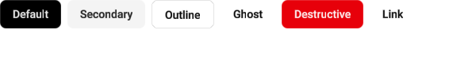
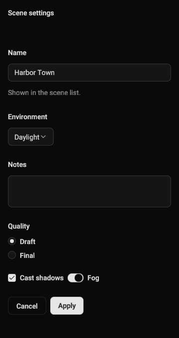
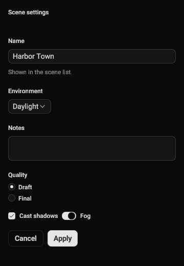

# shadcn components

<p class="awake-lede">Ready-made buttons, fields, menus, dialogs and layout blocks in the visual language of shadcn/ui, built on AwakeKt Compose. A theme you choose supplies every colour, radius and spacing.</p>

<div class="awake-badges" markdown>
<span class="awake-badge">module: <code>awake:ui:shadcn</code></span>
<span class="awake-badge awake-badge--ok">Vulkan</span>
<span class="awake-badge awake-badge--ok">WebGPU</span>
<span class="awake-badge">Desktop · Android · iOS · Web</span>
</div>

<div class="awake-figures" markdown>
<figure markdown>

<figcaption>Button variants, light theme</figcaption>
</figure>
</div>

Add `com.awakekt.awake.ui:shadcn` (catalog alias `libs.awake.ui.shadcn`) to `commonMain`. It brings
AwakeKt Compose Foundation with it. The components are ordinary [AwakeKt Compose](ui.md) functions,
so everything on that page applies here.

## Wrap your UI in a theme

Every shadcn component reads the theme in scope. Wrap the UI that uses them in
`provideShadcnTheme(values) { … }`.

```kotlin title="Kotlin"
--8<-- "awake/ui/shadcn/src/desktopTest/kotlin/com/awakekt/awake/ui/shadcn/ShadcnDocsSampleTest.kt:themed-button"
```

!!! warning "No theme, no component"
    A shadcn component outside `provideShadcnTheme` throws `IllegalArgumentException`. Its message starts
    "No shadcn theme in scope. Wrap this content in provideShadcnTheme { }". There is no
    fallback theme, so a missing provider fails where it is missing instead of drawing the wrong
    colours.

## Choose a theme

`shadcnThemeValues(…)` builds a complete theme from four choices.

```kotlin title="Kotlin"
--8<-- "awake/ui/shadcn/src/desktopTest/kotlin/com/awakekt/awake/ui/shadcn/ShadcnDocsSampleTest.kt:custom-theme"
```

| Parameter | Type | Default | What it does |
| --- | --- | --- | --- |
| `preset` | `ShadcnStylePreset`: `Vega` · `Nova` · `Maia` · `Lyra` · `Mira` · `Luma` · `Sera` · `Rhea` | `Vega` | Base corner radius and spacing. `Vega` matches shadcn's new-york-v4 metrics. |
| `baseColor` | `ShadcnBaseColor`: `Neutral` · `Stone` · `Zinc` · `Mauve` · `Olive` · `Mist` · `Taupe` | `Neutral` | The grey scale behind every surface, border and text colour. |
| `accent` | `ShadcnAccent`: `Base`, or one of `Amber` · `Blue` · `Cyan` · `Emerald` · `Fuchsia` · `Green` · `Indigo` · `Lime` · `Orange` · `Pink` · `Purple` · `Red` · `Rose` · `Sky` · `Teal` · `Violet` · `Yellow` | `Base` | Replaces the primary colour, its foreground, and the focus ring. `Base` keeps the base colour's own. |
| `dark` | `Boolean` | `true` | Dark or light palette. |

The `ShadcnTheme` object is the default theme: `Vega`, `Neutral`, `Base`, dark. Wrap it as
`ShadcnThemeValues(ShadcnTheme)` to provide it.

## Choose a density

Components take shadcn's own sizes by default. A dense UI, such as an editor, can ask for the next
size down once instead of passing a small size at every call. `LocalShadcnDensity` holds the density
for its content; it is `ShadcnDensity.Default` when nothing provides one, so a UI that never mentions
it is unchanged.

```kotlin title="Kotlin"
--8<-- "awake/ui/shadcn/src/desktopTest/kotlin/com/awakekt/awake/ui/shadcn/ShadcnDocsSampleTest.kt:compact-density"
```

<div class="awake-figures" markdown>
<figure markdown>

<figcaption><code>Default</code></figcaption>
</figure>
<figure markdown>

<figcaption><code>Compact</code></figcaption>
</figure>
</div>

Only size and spacing change. Colours, radii and fonts are the theme's, and the one type change is
`text-xs` for form labels and descriptions where shadcn uses `text-sm`. A size you pass, such as
`size = ShadcnButtonSizeVariant.Lg`, always wins over the density.

| Component | `Default` | `Compact` |
| --- | --- | --- |
| Button, button group member | 36 dp (`Default`) | 32 dp (`Sm`) |
| Input, input group, combobox field | 36 dp, `px-3` | 28 dp, `px-2` |
| Textarea | at least 64 dp | at least 48 dp |
| Select trigger | 36 dp, `px-3` | 28 dp, `px-2` |
| Select, combobox, menu and context menu rows | 32 dp | 28 dp |
| Checkbox | 16 dp | 14 dp |
| Switch | 32 × 18 dp | 28 × 16 dp |
| Radio ring, option gap | 16 dp, 12 dp | 14 dp, 8 dp |
| Toggle | 40 dp | 32 dp |
| Toggle group item | 36 dp (`Default`) | 32 dp (`Sm`) |
| Tabs, every variant | 36 dp (`Default`) | 28 dp (`Sm`) |
| Table head, cell padding | 40 dp, `p-2` | 32 dp, `px-2 py-1.5` |
| List item row (`ShadcnItem`, command palette) | `px-4 py-3` | `px-3 py-2` |
| Label, field label, field description | `text-sm` | `text-xs` |
| Field, field group and field set gaps | 12, 28, 24 dp | 8, 20, 16 dp |
| Popover and hover card padding | `p-4` | `p-3` |

The icon sizes (`Icon`, `IconSm`, `IconXs`) are always passed, so they stay as written: a dense UI
asks for `IconSm` or `IconXs` by name.

## Read theme tokens

Inside `provideShadcnTheme`, `shadcnTheme` returns the theme in scope. Use its tokens instead of
fixed colours, so your own components follow the theme.

```kotlin title="Kotlin"
--8<-- "awake/ui/shadcn/src/desktopTest/kotlin/com/awakekt/awake/ui/shadcn/ShadcnDocsSampleTest.kt:read-tokens"
```

| Token group | Members |
| --- | --- |
| `palette` | `background`, `foreground`, `primary`, `primaryForeground`, `secondary`, `secondaryForeground`, `muted`, `mutedForeground`, `accent`, `accentForeground`, `destructive`, `destructiveForeground`, `border`, `input`, `ring`, `card`, `cardForeground`, `popover`, `popoverForeground`, `sidebar` and its roles, `shadow`, `overlay` |
| `radii` | `xs` (0.4 × base), `sm` (0.6 ×), `md` (0.8 ×), `lg` (the preset's base radius), `xl` (1.4 ×), `full` |
| `metrics` | `panelPadding`, `surfacePadding`, `fieldPaddingX`, `fieldPaddingY`, `badgePaddingX`, `badgePaddingY`, `inputPaddingY`, `bandPaddingX` |
| `config` | The `preset`, `baseColor`, `accent` and `dark` the theme was built from. |

`shadow` is a base tint: apply your own alpha. `overlay` is a complete scrim colour, ready to draw.

## How it works

`provideShadcnTheme` puts the values in a `CompositionLocal` for its content. A nested
`provideShadcnTheme` wins inside its own content, and the outer theme returns after it closes. The
provider also sets the inherited text colour to `palette.foreground`, so plain `Text` inside it reads
on the theme's background.

Components hold the visual language: colours, radii, spacing and variants. Layout, drawing, input
and semantics come from AwakeKt Compose Foundation. If your app needs a different look, build your
own components on Foundation rather than overriding shadcn internals.

The module's components include alerts, avatars, badges, breadcrumbs, buttons and button groups,
calendars, cards, carousels, charts, checkboxes, comboboxes, commands, menus, dialogs, drawers,
fields and inputs, popovers, progress bars, radio groups, resizable panels, selects, sheets, sidebars,
sliders, switches, tables, tabs, toasts, toggles and tooltips. Each is a `Shadcn*` function in
`com.awakekt.awake.ui.shadcn.components`.

## See also

- [Button](../reference/components/button.md) reference.
- [UI with AwakeKt Compose](ui.md) for layout, state, hosting and tests.
- [Game UI](game-ui.md) for a HUD stored in a scene.
